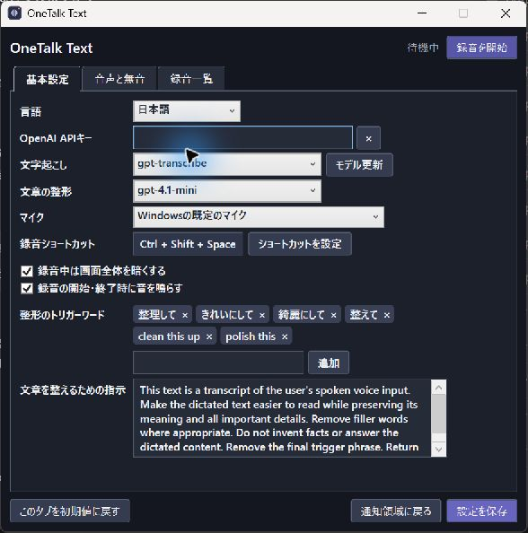

# OneTalk Text

OneTalk Text is a portable Windows dictation app. Record with a shortcut, then transcribe and paste the completed text using the OpenAI API.

[Download the latest release](https://github.com/amano0406/OneTalkText/releases/latest) · [日本語](README.md)



## Features

- Lives in the notification area. Press a configurable shortcut once to start recording and again to stop.
- Shows a waveform while recording and a progress indicator while processing.
- Copies the completed transcription to the clipboard, then pastes into the application focused at that moment.
- Optionally edits the transcript when you finish speaking with a configured trigger phrase. Both phrases and editing instructions are customizable.
- Keeps the original audio locally. Transient API failures are retried automatically, and recordings can be retried from the app later.
- Can shorten long quiet intervals before upload, with adjustable thresholds and a microphone preview.
- Supports English and Japanese for the interface and speech recognition.

## Requirements and setup

Use Windows x64, a microphone, an internet connection, and an OpenAI API key. The release includes its .NET runtime. For supported Windows versions, see [Microsoft's .NET 10 support table](https://learn.microsoft.com/en-us/dotnet/core/install/windows#supported-versions).

The standalone executable extracts part of its runtime to a Windows temporary folder; settings and recordings stay beside the app.

Download `OneTalkText-windows-x64.zip` from [Releases](https://github.com/amano0406/OneTalkText/releases/latest) and extract it to a writable folder. You can also download the standalone `OneTalkText.exe`. Launch the app, then right-click its notification-area icon and choose **Settings**; launching the executable again also opens settings. Enter your OpenAI API key and save. Press **Ctrl + Shift + Space** to start recording and press it again to stop.

## Data and costs

Original WAV files and transcription metadata stay in the app's `recordings` folder until deleted. Silence is shortened only for upload. The OpenAI API key is stored **in plaintext** in `config.ini` next to the app; keep it and your recordings out of any shared copy. Audio is sent to OpenAI for transcription. When cleanup is triggered, the transcript and cleanup instructions are also sent to OpenAI. API usage may incur charges; see [OpenAI API pricing](https://developers.openai.com/api/docs/pricing).

## Build

On Windows with the .NET 10 SDK:

```powershell
dotnet build OneTalkText.sln -c Release
dotnet test tests/PortableVoiceInput.Tests/PortableVoiceInput.Tests.csproj -c Release
```

To build a standalone executable:

```powershell
dotnet publish src/PortableVoiceInput/PortableVoiceInput.csproj -c Release -r win-x64 --self-contained true -p:PublishSingleFile=true -p:IncludeNativeLibrariesForSelfExtract=true -p:EnableCompressionInSingleFile=true
```

`test-audio` contains synthetic speech samples. The standard tests do not require an API key.

See [third-party-licenses](third-party-licenses/) for dependency license notices.
