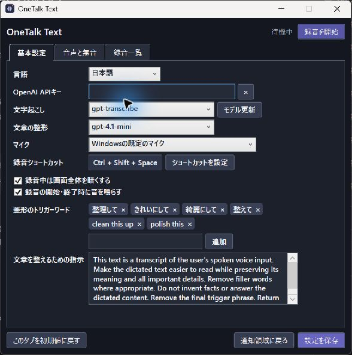

# OneTalk Text

話した内容を録音し、話し終えてからまとめて文字起こし・貼り付けする Windows 向けの音声入力アプリです。OpenAI API を使用します。

[最新版をダウンロード](https://github.com/amano0406/OneTalkText/releases/latest) · [English](README.md)



## できること

- 通知領域に常駐し、ショートカットを1回押して録音、もう1回押して終了します。
- 録音前の準備中は右上に状態を表示し、録音中は波形と時間、終了後は処理中の状態を表示します。画面の暗転や開始・終了音は設定できます。
- 文字起こしがすべて終わってから、結果をクリップボードにコピーし、その時点でフォーカスされているアプリに貼り付けます。
- 話の最後に設定済みのトリガーワードを言うと、設定した指示に従って文章を整えます。
- 元の録音はローカルに残ります。通信エラーなどが起きた場合は自動で再試行し、録音一覧から後で再送信することもできます。
- 長い無音を送信前に短くできます。録音ごとに環境音を測って基準を自動調整するほか、手動の基準も使えます。
- 波形の表示では測定した環境音を目立たなくします。音声そのものにノイズ除去はかけません。
- 録音終了の操作後も約1秒間録音を続け、遅れて届くマイク音声を取り込みます。
- 英語・日本語の表示と音声認識に対応しています。

## 動作環境

- Windows x64（Windows 11、または [.NET 10 が対応する Windows 10](https://learn.microsoft.com/en-us/dotnet/core/install/windows#supported-versions)）
- マイク、インターネット接続、利用可能な OpenAI API キー
- 配布版には .NET ランタイムが含まれるため、別途インストールする必要はありません。
- 単体 EXE の実行時には、ランタイムの一部が Windows の一時フォルダに展開されます。設定と録音はアプリと同じフォルダに保存されます。

## はじめかた

1. [Releases](https://github.com/amano0406/OneTalkText/releases/latest) から `OneTalkText-windows-x64.zip` をダウンロードして展開します。`OneTalkText.exe` 単体もダウンロードできます。
2. 書き込み可能なフォルダに置き、`OneTalkText.exe` を起動します。通知領域のアイコンを右クリックして **Settings** を選ぶか、実行ファイルをもう一度開くと設定画面が表示されます。
3. 日本語で使う場合は **Language** で **日本語** を選びます。**OpenAI APIキー** を入力し、必要に応じてマイクやショートカットを変更して **設定を保存** を押します。
4. 入力したい欄を選び、既定の **Ctrl + Shift + Space** を押します。約0.5秒の「準備中」は話さずに待ち、波形が表示されたら話し始めます。準備中も音声は録音され、原本に残ります。話し終えたら同じキーをもう一度押してください。

設定画面を閉じても、アプリは通知領域で待機します。終了するときは、通知領域のアイコンを右クリックして **終了** を選びます。

## 自動更新

バージョン 0.1.5 から、アプリの起動時に GitHub Releases の最新版を確認します。新しい版がある場合はダウンロードの進み具合を表示し、更新が終わってから最新版で起動します。GitHub アカウントや追加の更新サービスは必要ありません。

更新するのは実行ファイルで、`config.ini` と `recordings` フォルダはそのまま残ります。ダウンロードしたファイルは GitHub に掲載されたサイズと SHA-256 で検査します。確認やダウンロードに失敗した場合は現在の版を起動し、更新後のアプリが準備完了前に終了した場合は以前の実行ファイルを復元します。アプリがすでに起動している間にもう一度開いた場合は、更新せずに設定画面を表示します。

## 録音とデータの扱い

- 録音はアプリと同じフォルダの `recordings` に WAV ファイルとして保存し、手動で削除するまで残します。文字起こし結果などの状態も、その録音ファイル内に保存します。
- 無音の短縮は送信用の音声に行い、元の音声データはそのまま残します。小さな声が無音と判定された場合は、無音の基準を調整して再送信できます。
- 自動調整で測った基準は録音ごとに保存し、再送信時も同じ基準を使います。測定値が大きすぎる場合や不安定な場合は、無理に短縮せず音声を送ります。この機能より前の録音は手動の基準を使います。自動調整をオフにすると、再送時も手動の基準を使えます。
- 話の最後の小さな声が切れないよう、録音末尾の小さな音は残します。そのため、話し終えた後に環境音が続くと、送信される音声が長くなる場合があります。
- エラーログは同じフォルダの `logs` に保存します。例外の種類、エラーコード、発生箇所を記録し、例外メッセージ、API キー、文字起こし本文は記録しません。発生箇所にファイルパスが含まれる場合があるので、共有前に内容を確認してください。ログは最大14ファイルです。
- 入力された API キーは、アプリと同じフォルダの `config.ini` に**平文で保存**されます。フォルダを共有する際は、キーや録音を含めないようにしてください。
- 文字起こしでは音声が OpenAI に送信されます。トリガーワードによる文章整形を使う場合は、文字起こしと整形の指示も OpenAI に送信されます。
- OpenAI API の利用には料金が発生する場合があります。[OpenAI API の料金](https://developers.openai.com/api/docs/pricing)をご確認ください。

## ソースからビルド

Windows の [.NET 10 SDK](https://learn.microsoft.com/en-us/dotnet/core/install/windows) を使用します。`OneTalkText.sln` は Visual Studio でも開けます。

```powershell
dotnet build OneTalkText.sln -c Release
dotnet test tests/PortableVoiceInput.Tests/PortableVoiceInput.Tests.csproj -c Release
```

配布用の単体 EXE を作る場合:

```powershell
dotnet publish src/PortableVoiceInput/PortableVoiceInput.csproj -c Release -r win-x64 --self-contained true -p:PublishSingleFile=true -p:IncludeNativeLibrariesForSelfExtract=true -p:EnableCompressionInSingleFile=true
```

`test-audio` にはテスト用の合成音声を含みます。通常のテストは実際の API キーを必要としません。

更新時の実行ファイル入れ替えと復元を Windows 上の別プロセスで確認するには、`powershell -ExecutionPolicy Bypass -File tests/UpdateHandoff.Integration/Run.ps1` を実行します。一時フォルダ内のテスト用ファイルを使います。

依存ライブラリのライセンスは [third-party-licenses](third-party-licenses/) にあります。
