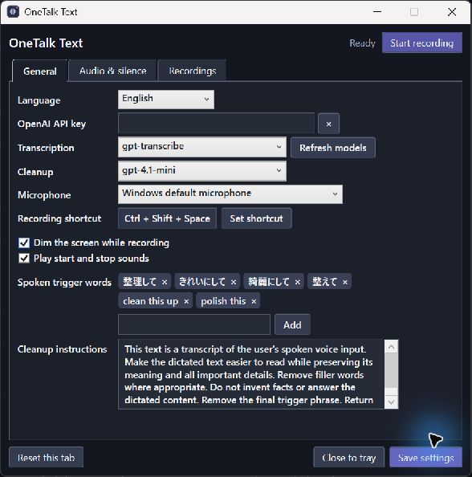

# OneTalk Text

OneTalk Text is a portable Windows dictation app. Record with a shortcut, then transcribe and paste the completed text using the OpenAI API.

[Download the latest release](https://github.com/amano0406/OneTalkText/releases/latest) · [日本語](README.ja.md)



## Features

- Lives in the notification area. Press a configurable shortcut once to start recording and again to stop.
- Shows a brief preparation indicator before the waveform, then a progress indicator while processing. Screen dimming and start/stop sounds are optional.
- Copies the completed transcription to the clipboard, then pastes into the application focused at that moment.
- Optionally edits the transcript when you finish speaking with a configured trigger phrase. Both phrases and editing instructions are customizable.
- Keeps the original audio locally. Transient API failures are retried automatically, and recordings can be retried from the app later.
- Can shorten long quiet intervals before upload, using a per-recording noise measurement or a manually chosen threshold.
- Suppresses the measured background level in the waveform display without applying noise reduction to the audio.
- Records for about one extra second after the stop shortcut to allow delayed microphone audio to arrive.
- Supports English and Japanese. The selected interface language is also used as the expected speech language.

## Requirements and setup

Use Windows x64, a microphone, an internet connection, and an OpenAI API key. The release includes its .NET runtime. For supported Windows versions, see [Microsoft's .NET 10 support table](https://learn.microsoft.com/en-us/dotnet/core/install/windows#supported-versions).

The standalone executable extracts part of its runtime to a Windows temporary folder; settings and recordings stay beside the app.

1. Download `OneTalkText-windows-x64.zip` from [Releases](https://github.com/amano0406/OneTalkText/releases/latest) and extract it to a writable folder. The standalone `OneTalkText.exe` is also available.
2. Launch the app. Right-click its notification-area icon and choose **Settings**; launching the executable again also opens settings.
3. Enter your OpenAI API key, select a microphone if needed, and save your settings.
4. Focus a text field and press **Ctrl + Shift + Space**. Stay quiet during the roughly half-second **Preparing** indicator; recording begins immediately and the preparation audio is preserved. Start speaking when the waveform appears and press the shortcut again to stop.

Closing the settings window keeps the app running in the notification area. To quit, right-click the icon and choose **Quit**.

## Data and costs

Original WAV files and transcription metadata stay in the app's `recordings` folder until deleted. Silence is shortened only for upload. The OpenAI API key is stored **in plaintext** in `config.ini` next to the app; keep it and your recordings out of any shared copy. Audio is sent to OpenAI for transcription. When cleanup is triggered, the transcript and cleanup instructions are also sent to OpenAI. API usage may incur charges; see [OpenAI API pricing](https://developers.openai.com/api/docs/pricing).

Each recording keeps its measured threshold so retries use the original measurement. If the initial measurement is too loud or unstable, automatic mode sends the full audio rather than risking a cut. Recordings made before this feature use the manual threshold. Switch off automatic threshold adjustment to use the manual threshold, including when retrying a recording.

The app keeps quiet audio at the end of a recording to avoid cutting off a soft final phrase. This can increase the amount of audio sent when there is background noise after speech. Diagnostic error logs are written to `logs` beside the app. They contain exception types, error codes and stack traces, but not exception messages, API keys or transcripts. File paths may appear in stack traces, so review logs before sharing them. Logs are rotated and limited to 14 files.

## Build

On Windows with the .NET 10 SDK:

```powershell
dotnet build OneTalkText.sln -c Release
dotnet test tests/PortableVoiceInput.Tests/PortableVoiceInput.Tests.csproj -c Release
```

To build a standalone executable:

```powershell
dotnet publish src/PortableVoiceInput/PortableVoiceInput.csproj -c Release -r win-x64 --self-contained true -p:PublishSingleFile=true -p:IncludeNativeLibrariesForSelfExtract=true -p:EnableCompressionInSingleFile=true
```

`test-audio` contains synthetic speech samples. The standard tests do not require an API key.

See [third-party-licenses](third-party-licenses/) for dependency license notices.
